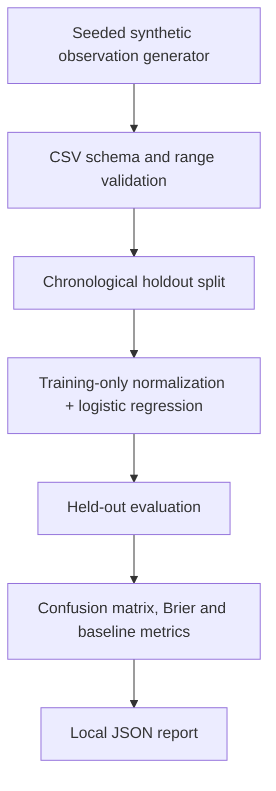
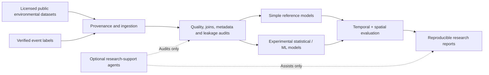

# Architecture / Arquitectura

## Current executable path (v0.1)

- **Python package:** `src/andes_risk/`.
- **Entry point:** `python -m andes_risk` or `andes-risk` after editable install.
- **Tests:** `tests/`, run with `python -m unittest discover -s tests -v`.
- **Static site:** `public/`, deployed on Render. Its synthetic slider visualization is independent of the Python model. It is **not** a production inference frontend.
- **Infrastructure:** `render.yaml` publishes the static `public` directory.

## Research target architecture (NOT IMPLEMENTED)

Do not interpret the target diagram as functionality already delivered.

## Design principles

1. Keep scientific data provenance explicit and auditable.
2. Preserve deterministic, low-dependency baselines.
3. Make synthetic and observational experiments distinguishable in results and reports.
4. Respect temporal/spatial holdouts and guard against leakage.
5. Keep AI-generated code and scientific claims subject to independent validation.
6. Never issue automatic risk warnings from unvalidated models.

## Extending the project

Future packages could include `ingestion/`, `geospatial/`, `models/`, `agents/` and `reporting/`. These are *proposed modules*, not part of v0.1.

## Plan modular propuesto

La implementación actual y su interfaz de línea de comandos se conservan como punto de partida. Las siguientes responsabilidades son una **propuesta**, no directorios ni servicios existentes:

| Módulo futuro | Responsabilidad | Salida o límite esperado |
| --- | --- | --- |
| `ingestion/` | Adaptadores independientes por fuente; descarga o importación explícita y validación inicial. | Datos originales sin modificar y manifiesto con versión, cobertura, licencia, fecha de acceso y checksum. |
| `geospatial/` | Normalización de coordenadas, recorte, elevación, pendiente y uniones espacio-temporales. | Transformaciones reproducibles con CRS, resolución, unidades, método y calidad registrados. |
| `experiments/` y `models/` | Preparación de características, referencias estadísticas y modelos experimentales. | Configuración y semillas registradas; transformaciones ajustadas dentro de cada partición de entrenamiento. |
| `evaluation/` y `reporting/` | Separaciones temporales y geográficas, métricas, calibración y documentación de resultados. | Informes versionados, con tamaños de muestra, incertidumbre y comparación con referencias. |
| `api/` | Acceso de solo lectura a datos y resultados autorizados y versionados. | Contratos que incluyan procedencia, estado, fecha y errores; no inferencia operativa. |
| `agents/` | Asistencia opcional para preparación, auditoría y documentación. | Operaciones registradas y revisión humana e independiente; sin publicación ni alertas autónomas. |

`public/` continúa siendo una aplicación estática separada del paquete Python. Una API futura requeriría un servicio adicional: la configuración actual de Render publica archivos estáticos y no ejecuta Python. La interfaz debe distinguir datos observados, simulados y ausentes, indicar la fuente de cualquier capa y mostrar fallos de carga de forma explícita. Un mapa base no implica que existan capas de amenaza verificadas.

### Secuencia sugerida

1. Mantener las pruebas y el flujo sintético existente; documentar claramente el origen de cada resultado.
2. Definir unidad espacial y temporal, esquema de metadatos y criterios de aceptación; después incorporar una fuente por vez con pruebas y registro de procedencia.
3. Crear conjuntos observacionales solo tras verificar permisos, etiquetas y cobertura. La falta de un evento en un inventario no demuestra su ausencia.
4. Implementar comparaciones reproducibles con divisiones temporales y geográficas independientes; reservar una evaluación final separada de la selección del modelo.
5. Exponer resultados revisados mediante una API y visualizaciones trazables; incorporar agentes únicamente después de contar con registros y mecanismos de revisión.

Cada etapa requiere revisión científica y no autoriza por sí sola el uso para alertas o decisiones de seguridad.

