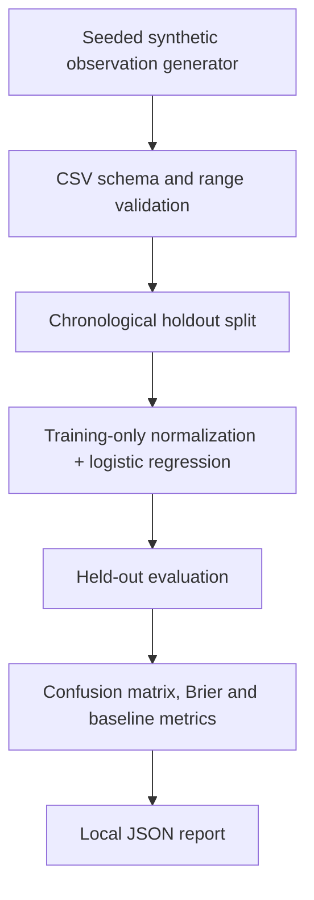
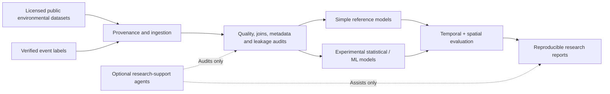

# Architecture / Arquitectura

## Current executable path (v0.1)

- **Python package:** `src/andes_risk/`.
- **Entry point:** `python -m andes_risk` or `andes-risk` after editable install.
- **Tests:** `tests/`, run with `python -m unittest discover -s tests -v`.
- **Static site:** `public/`, deployed on Render. Its synthetic slider visualization is independent of the Python model. It is **not** a production inference frontend.
- **Infrastructure:** `render.yaml` publishes the static `public` directory.

## Research target architecture (NOT IMPLEMENTED)

Do not interpret the target diagram as functionality already delivered.

## Design principles

1. Keep scientific data provenance explicit and auditable.
2. Preserve deterministic, low-dependency baselines.
3. Make synthetic and observational experiments distinguishable in results and reports.
4. Respect temporal/spatial holdouts and guard against leakage.
5. Keep AI-generated code and scientific claims subject to independent validation.
6. Never issue automatic risk warnings from unvalidated models.

## Extending the project

Future packages could include `ingestion/`, `geospatial/`, `models/`, `agents/` and `reporting/`. These are *proposed modules*, not part of v0.1.
